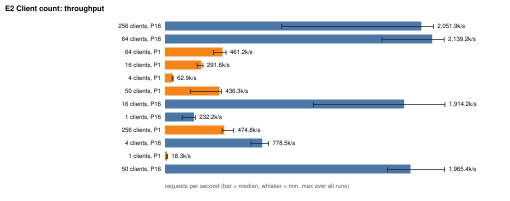
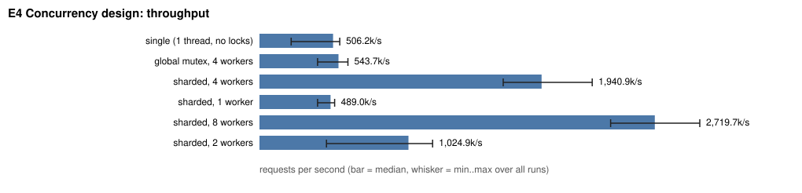
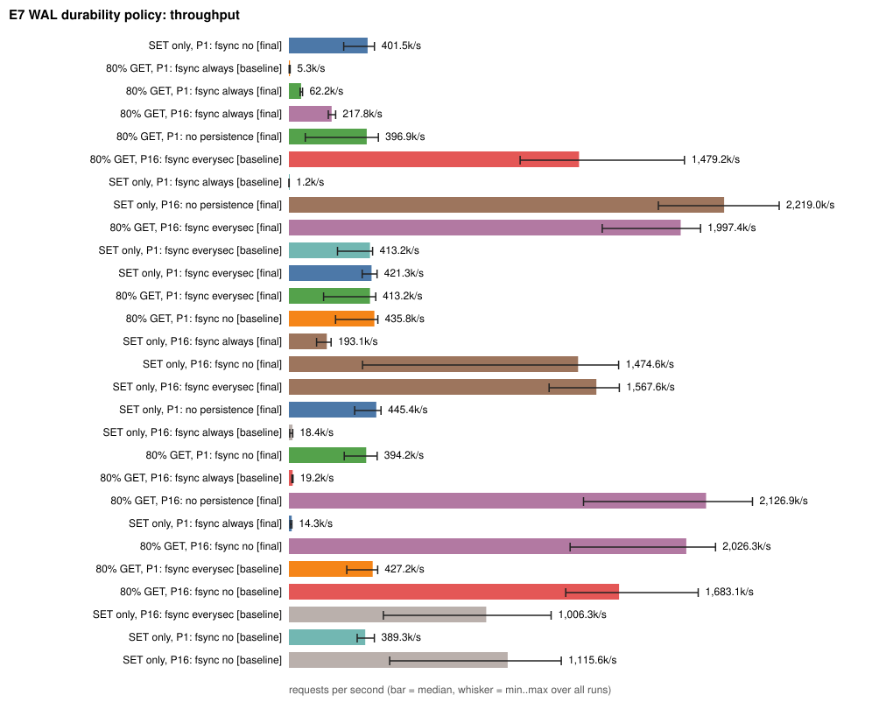
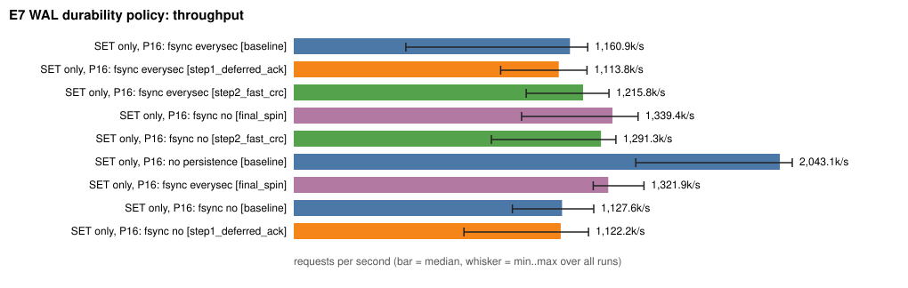

# DistCache

A Redis-compatible in-memory cache written from scratch in C++17: RESP protocol over TCP, TTL
expiration, LRU eviction, a multi-threaded server with two interchangeable locking designs (one
global mutex, or sharded locks) tested under ThreadSanitizer, a write-ahead log with snapshots and
crash recovery, and a reproducible benchmark harness with a profiled, measured cost for every one
of those features.

You can talk to it with the real `redis-cli`.

```bash
cmake -S . -B build -G Ninja && cmake --build build
./build/distcache --mode sharded --threads 4          # listens on 6380
redis-cli -p 6380 SET session:1 abc EX 60
redis-cli -p 6380 GET session:1
redis-cli -p 6380 INFO
```

| Phase | Status |
|---|---|
| 1. TCP + RESP server, `SET`/`GET`/`DEL` | done |
| 2. TTL: lazy + active expiration | done |
| 3. LRU eviction, O(1) | done |
| **4. Concurrency: worker threads, global lock, sharded locks** | **done (this document)** |
| 5. Durability: write-ahead log, snapshots, crash recovery, fsync policies | done (see "Phase 5" below) |
| **6. Benchmark harness, profiling of the WAL, deferred-ack group commit** | **done** (see "Phase 6" below) |
| 7-10. Consistent hashing, replication, rate limiter, failure testing | planned |

Commands: `PING ECHO SET(EX|PX) GET DEL EXPIRE PEXPIRE TTL PTTL PERSIST DBSIZE INFO SAVE`.

```
distcache [--port N] [--threads N] [--mode single|global|sharded] [--shards N] [--max-keys N]
          [--dir PATH [--fsync always|everysec|no] [--snapshot-mb N]]
```

---

## Phase 4: concurrency

### 1. What is shared, and what had to change

Before Phase 4 the server was one thread running one epoll loop, so nothing was shared. Once
several threads serve clients, this state is touched by more than one thread:

| Shared mutable state | Mutated by | Notes |
|---|---|---|
| hash map `key -> {value, deadline, lru position}` | set, del, **get** (lazy expiry), sweep, eviction | |
| LRU list | **every get**, set, del, sweep, eviction | the list is relinked on reads |
| deadline index (`std::set<(deadline,key)>`) | set, expire, persist, del, sweep, eviction | |
| `evicted_` / `expired_` counters | get (lazy expiry), sweep, eviction | read by `INFO` |
| connection table (fd -> buffers) | the owning worker only | made private per worker, so it needs no lock |

One logical key lives in **three** structures at once (map, LRU list, deadline index). They must
change together. A thread that observes them half-updated can follow a dangling list pointer or
erase the wrong deadline entry. That defines the critical section: **one engine operation = one
lock, held from start to finish.**

### 2. Why `GET` needs synchronization (it is not a read)

```cpp
std::optional<std::string> get(const std::string& key) {
    auto it = live(key);          // may ERASE the key if its TTL passed  -> writes map, LRU, index
    if (it == map_.end()) return std::nullopt;
    touch(it);                    // relinks the LRU list node             -> writes the list
    return it->second.value;
}
```

A cache with LRU turns every read into a write. Two concurrent `get`s would both splice the same
doubly linked list. That is why this project uses a plain `std::mutex` and **not** a
`std::shared_mutex`: a reader/writer lock only helps when readers really are read-only, and here
they never are. (Making reads truly read-only would mean approximating LRU, e.g. sampling or
CLOCK, which is the design Redis chose. That is a possible later experiment.)

### 3. The race, reproduced

`tests/race_demo.cpp` runs a mixed workload from 8 threads against the **unsynchronized** `Store`
(the Phase 3 engine logic, now behind the `Engine` interface, with no locks added), built with `-fsanitize=thread`:

```bash
cmake -S . -B /tmp/build-tsan -G Ninja -DCMAKE_BUILD_TYPE=Debug -DCMAKE_CXX_FLAGS="-fsanitize=thread -g -O1"
cmake --build /tmp/build-tsan --target race_demo
/tmp/build-tsan/race_demo unsafe 8 3000
```

Measured result (full log in `docs/tsan-unsafe.txt`):

* **103 ThreadSanitizer data-race reports**, on `Store::live`, `sweep`, `drop_expiry`, `set`,
  `erase`, `get` and `touch`. That is every structure above.
* The process then **crashed with a segmentation fault** inside `drop_expiry`
  (`SUMMARY: ThreadSanitizer: SEGV ... store.hpp:202`): concurrent inserts and erases had
  corrupted the deadline index's tree.

First report, abridged:

```
WARNING: ThreadSanitizer: data race
  Read of size 8 by thread T2:   Store::sweep()    store.hpp:123   (expiries_.empty())
  Previous write of size 8 by T1: Store::set_deadline()  store.hpp:198   (expiries_.emplace)
```

The number of reports before the crash varies from run to run (103 in the logged run, 23 in a
later re-run on the final tree); it is the crash point that changes, not the outcome.

The same workload through the two safe engines: **0 reports**, structures consistent
(`docs/tsan-global.txt`, `docs/tsan-sharded.txt`).

### 4. Architecture

```
                    +-------------------- Server ---------------------+
 clients --TCP-->   | acceptor thread: accept(), round-robin handoff  |
                    |   |            |            |            |       |
                    |   v            v            v            v       |
                    | worker 0     worker 1     worker 2     worker 3  |   each worker = 1 thread
                    | own epoll    own epoll    own epoll    own epoll |   + its own epoll
                    | own conns    own conns    own conns    own conns |   + its OWN connections
                    +----+-----------+------------+------------+-------+
                         |  execute(Engine&, args)  -- the ONLY shared state is the Engine
                         v
                  +--------------- Engine (interface) ----------------+
                  |  Store            no locks (1 thread only)         |
                  |  GlobalLockStore  1 mutex -> 1 Store               |
                  |  ShardedStore     N x (mutex -> Store)             |
                  +----------------------------------------------------+
```

* A connection belongs to **one worker for life**, so its buffers need no lock. The acceptor
  hands a new socket to a worker through a mutex-protected queue plus an `eventfd` that wakes the
  worker's `epoll_wait`.
* Workers never block on a slow client: sockets are non-blocking and epoll reports readiness.
  Pipelined commands are parsed from the buffer and answered in order.
* Active expiration: every worker calls `engine.sweep()` about every 100 ms. The engine serializes
  it. In `single` mode there is exactly one worker, so the unsynchronized store is still safe.
* The command layer (`execute`) works on the `Engine` interface, so the locking strategy is chosen
  at startup with `--mode`.

### 5. Locking strategies

**Global lock** (`GlobalLockStore`): one mutex around one `Store`. Strictly correct, exact global
LRU order, exact stats. Every operation on every key queues on the same lock.

**Sharded** (`ShardedStore`): `hash(key) % N` picks a shard. Each shard is a complete `Store`
(map, LRU list, deadline index, counters) behind its own mutex, so operations on different shards
run in parallel. Shards are `alignas(64)` so neighbouring locks do not share a cache line.

Deadlock avoidance: **no method ever holds two locks.** Each takes one lock, does its work, and
releases it. With no nesting there is no lock-order cycle to break. Values are copied out before
unlocking so no reference outlives the lock.

What shard-level locking can and cannot do:

| Operation | Lock needed | Why |
|---|---|---|
| `SET GET DEL TTL EXPIRE PERSIST` (single key) | its one shard | map, LRU list, deadline index for a key all live in that shard |
| LRU eviction | its one shard | LRU is **per shard**: a shard evicts its own oldest key. Capacity is split `ceil(max_keys/N)` per shard |
| `sweep()` | one shard at a time, in turn | starts at a rotating shard so a busy shard 0 cannot consume the whole budget |
| `INFO`, `DBSIZE`, `size()` | one shard at a time | each term is exact, but the **sum is not an atomic snapshot** under concurrent writes |
| `DEL a b c` (multi-key) | one shard per key | **not atomic as a group** (same as Redis Cluster) |

The cost: LRU becomes **approximate**. A hot shard can evict a key that is more recent than a
cold shard's oldest. Strict global LRU would need one shared list that every `GET` locks, which
is exactly the bottleneck sharding removes. This is measured below.

### 6. Tests

`distcache_tests`: **84 tests** (the Phase 1-3 tests are unchanged and still pass).

| Area | Tests |
|---|---|
| Concurrent `GET` storm (8 threads x 10k, every value checked, LRU list stays valid) | global + sharded |
| Concurrent `SET`/`GET`/`DEL` on 64 overlapping keys (no torn or foreign values) | global + sharded |
| Disjoint keys end in exactly the expected state | global + sharded |
| Concurrent expiration: writers, readers, `expire`, `persist`, a sweeper thread | global + sharded |
| Concurrent LRU updates: an observer thread asserts `size() <= capacity` at every instant | global + sharded |
| Concurrent eviction: `size + evicted == inserted` exactly | global + sharded |
| Mixed workload with `INFO`/`DBSIZE`/`sweep` running alongside | global + sharded |
| Real server, real TCP clients: 16 clients on own keys, 12 clients on one hot key, 400-command pipeline, byte-at-a-time command, connection churn, active expiry with no traffic, abrupt disconnect, malformed input | single + global + sharded |
| Sharded design: sweep budget across shards, capacity division, same key -> same shard | unit |
| Fuzz: 20,000 random ops, `consistent()` checked after **every** op | unit |

`consistent()` verifies that the map, LRU list and deadline index agree (sizes match, every list
node points back at its entry, every TTL has exactly one index entry). It runs after every
concurrent test, so a lost update shows up as a failure and not as a silent leak.

Results (84 tests each; sanitizer builds were re-run on the final tree, 3 shuffled repeats each, after an
earlier pass of 5-8 repeats):

| Build | Result |
|---|---|
| Release | 84/84 pass (and 30 consecutive shuffled repeats) |
| AddressSanitizer (+LeakSanitizer) | 84/84 pass, 0 reports (5 repeats) |
| UndefinedBehaviorSanitizer (`-fno-sanitize-recover`) | 84/84 pass, 0 reports |
| **ThreadSanitizer** | **84/84 pass, 0 reports** (8 shuffled repeats) |

### 7. Benchmarks

Environment: WSL2 Ubuntu on Windows 11, 12 logical CPUs, 3.7 GB RAM, g++ 15.2 `-O3`. Client and
server share the machine. **Treat absolute numbers as indicative, not portable**: this is a
virtualized laptop-class environment and run-to-run variance is large (ranges are shown).
Raw data: `docs/benchmarks/`. Reproduce with `scripts/bench_engine.sh` and `scripts/bench_net.sh`.

#### 7a. In-process: lock contention in isolation (`bench_engine`, no sockets)

100k keys, 64-byte values, 3 s runs, median of 3 runs (ops/second, M = millions). Sharded uses 16
shards in this table.

90% GET / 10% SET. Unsynchronized single-thread baseline: **2.16M**

| threads | global mutex | sharded (16) | sharded / global |
|---|---|---|---|
| 1 | 1.97M | 2.02M | 1.03x |
| 2 | 0.65M | 1.92M | 2.94x |
| 4 | 0.56M | 2.34M | 4.16x |
| 8 | 0.56M | 3.42M [2.56-4.11] | 6.08x |
| 12 | 0.57M | 2.51M [2.22-2.85] | 4.39x |

50% GET / 50% SET. Baseline: **1.54M**

| threads | global mutex | sharded (16) | sharded / global |
|---|---|---|---|
| 1 | 1.61M | 1.90M | 1.19x |
| 2 | 0.64M | 2.00M | 3.12x |
| 4 | 0.70M | 3.00M | 4.28x |
| 8 | 0.72M | 4.26M | 5.92x |
| 12 | 0.66M | 4.99M | 7.58x |

What this shows:

* **The global lock gets slower when threads are added**: 2.0M ops/s with 1 thread falls to
  0.65M with 2 and stays near 0.6M. Threads spend their time contending for the one lock and
  bouncing its cache line between cores (lock convoy), not working.
* **Sharding recovers the parallelism**, up to roughly 6x the global lock at 8 threads (90% GET).
* Scaling is **not linear** (8 threads reach about 1.6x the single-thread baseline at 16 shards,
  not 8x). Random access over 100k keys is memory-bound, and the 16-shard run is noisy.
* Uncontended cost of locking: 1 thread sharded 2.02M vs unsynchronized 2.16M, about 7%.

Shard count, 8 threads, 90% GET (median [min-max]):

| shards | 1 | 2 | 4 | 8 | 16 | 64 | 256 |
|---|---|---|---|---|---|---|---|
| ops/s | 0.81M | 1.35M | 2.14M | 3.06M | 3.42M [2.56-4.11] | 4.43M | 9.22M |

A second sweep taken later (3 runs each, ops/s) was noisy: 64 shards 5.1-7.1M; 256 shards
8.6-9.0M; 1024 shards 3.4-11.5M; 4096 shards 5.7-10.1M. The consistent finding is that **more
shards help until contention is gone (roughly 256 here), then plateau**. Caveat on the table:
the 1-shard row (0.81M) is structurally the same as the global mutex (0.56M in the earlier
table); the gap is a measure of the environment's run-to-run noise at this contention level, so
do not read fine differences between neighbouring cells.

#### 7b. LRU accuracy: what sharding costs (`bench_lru_accuracy`)

Cyclic access over a working set of W keys on a store with capacity C. An exact LRU keeps all
W <= C keys (100% hits). Hit rate after warm-up:

C = 1,000

| working set | 1 shard | 4 | 16 | 64 | 256 |
|---|---|---|---|---|---|
| 50% of C | 100.0 | 100.0 | 100.0 | 100.0 | 83.2 |
| 80% of C | 100.0 | 100.0 | 100.0 | 86.4 | 62.6 |
| 95% of C | 100.0 | 73.3 | 78.7 | 54.8 | 50.1 |

C = 100,000

| working set | 1 shard | 4 | 16 | 64 | 256 |
|---|---|---|---|---|---|
| 50% of C | 100.0 | 100.0 | 100.0 | 100.0 | 100.0 |
| 80% of C | 100.0 | 100.0 | 100.0 | 100.0 | 100.0 |
| 95% of C | 100.0 | 100.0 | 100.0 | 100.0 | 83.9 |

Keys hash unevenly, so some shards receive more keys than their slice holds and thrash, even
though the store as a whole has room. The damage depends on **keys per shard**, not shard count.
So the server applies a guard: with `--max-keys`, it uses at most `max_keys / 1024` shards
(at least one), and prints a note when it reduces your `--shards`. The default is 64 shards when
no capacity is set (no eviction, so no accuracy cost).

#### 7c. End to end over TCP (`redis-benchmark`)

Real server, loopback, 64-byte values, random keys from a 100k keyspace, `redis-benchmark
--threads 4`. 3 runs per cell; table shows median throughput in thousands of requests/second
with [min-max], and p50 / p99 latency in milliseconds. `global-4w` and `sharded-4w` use 4 worker
threads; `single` is the unsynchronized engine on one worker thread. Every run in the 10+ client
rows lasted at least 4.5 s (a first pass with shorter pipelined runs was discarded: the tool's
time resolution is too coarse below a couple of seconds; see `scripts/bench_net.sh`).

GET

| clients, pipeline | single | global-4w | sharded-4w |
|---|---|---|---|
| 1, 1 | 16.0k 0.055/0.135 | 13.8k 0.055/0.207 | 14.2k 0.055/0.167 |
| 10, 1 | 59.0k [44-62] 0.127/0.407 | 166.5k [167-176] 0.039/0.175 | 168.3k [121-200] 0.039/0.159 |
| 50, 1 | 69.4k [64-72] 0.535/3.047 | 292.1k [248-300] 0.103/0.455 | 299.9k [225-307] 0.079/0.599 |
| 200, 1 | 66.5k [61-84] 1.687/11.351 | 278.6k [184-324] 0.511/2.735 | 342.2k [315-352] 0.303/1.255 |
| **50, 16** | **464.6k** [427-484] 1.343/11.407 | **423.0k** [403-435] 1.455/10.495 | **1390.3k** [1291-1775] 0.407/1.887 |

SET

| clients, pipeline | single | global-4w | sharded-4w |
|---|---|---|---|
| 1, 1 | 13.8k 0.055/0.183 | 13.8k 0.055/0.183 | 14.8k 0.055/0.167 |
| 10, 1 | 64.0k [64-69] 0.119/0.359 | 134.3k [114-158] 0.039/0.239 | 171.2k [153-200] 0.039/0.175 |
| 50, 1 | 80.0k [53-89] 0.535/1.391 | 272.4k [189-279] 0.103/0.583 | 278.6k [238-299] 0.087/0.695 |
| 200, 1 | 75.6k [73-80] 1.639/8.607 | 278.5k [226-343] 0.511/2.543 | 332.5k [238-352] 0.311/1.767 |
| **50, 16** | **478.6k** [406-584] 1.223/11.095 | **479.4k** [444-510] 1.359/8.775 | **1292.4k** [1256-1409] 0.407/5.863 |

What this shows, and what it does not:

* Worker threads (either locking design) give **about 2-4x** the throughput of one thread once
  there are 10+ clients (2.1x for SET at 10 clients, 4.2x for GET at 50), and cut p50 latency (50 clients: 0.535 ms single vs about 0.08-0.10 ms),
  because the single thread is the bottleneck.
* **Without pipelining, global and sharded are nearly tied.** Each request costs a socket
  read/write syscall pair, which dwarfs the microseconds spent under the lock, so lock
  contention is hidden. With 1 client all three are equal (about 14-16k): that is network round
  trip, not the cache.
* **With pipelining (16 commands per round trip), the locking design decides the outcome.**
  Syscall cost is amortized, the lock becomes the hot spot, and:
  `global-4w` performs about the same as the single thread (**4 threads bought nothing**),
  while `sharded-4w` reaches about **3x** both. This agrees with the in-process result.
* p99 is high for `single` and `global` under pipelining (8.8-11.4 ms) versus 1.9-5.9 ms for
  sharded: the queue behind the lock shows up in the tail.
* Caveats: `redis-benchmark` runs on the same 12 CPUs as the server and may itself be the limit
  at the highest rates. Throughput varies a lot between runs (ranges above). This is loopback,
  not a real network. No claim is made about absolute speed versus real Redis.

### 8. Known tradeoffs and limitations

* **Sharded LRU is approximate** (section 5, 7b). Strict global LRU needs a global lock.
* **`INFO` / `DBSIZE` under sharding are not atomic snapshots** while writes are in flight.
* **Multi-key `DEL` is not atomic** across shards.
* **No `MULTI`/transactions, no blocking commands.** Not needed yet; they would need cross-shard
  coordination.
* **Connections are balanced round-robin at accept time**, not by load. One very heavy connection
  pins its worker.
* **A worker's loop is not preemptible**: a huge pipelined batch from one client delays other
  clients on the same worker.
* **Active expiration is a periodic sweep driven by worker loops**, up to 1000 keys per call; a
  mass expiry drains over several ticks. Lazy expiration keeps reads correct meanwhile.
* **Hash-sharding does not fix a single hot key**: all traffic for one key still hits one lock.
* **Deadlines use `steady_clock`**, which is meaningless after a restart. Phase 5 (WAL) must log
  wall-clock deadlines.
* Memory is bounded by key count (`--max-keys`), not bytes.
* Linux only (epoll, eventfd).

### 9. Request flow for a concurrent request

`SET session:123 abc EX 60` arriving while 3 other clients are active:

1. The **acceptor** thread accepted this client earlier, picked worker 2 (round robin), pushed the
   socket onto worker 2's pending queue and wrote its `eventfd`. Worker 2 woke, registered the fd
   in its own epoll, and owns it from now on.
2. Worker 2's `epoll_wait` reports the fd readable. It `read()`s into the connection's input
   buffer (private to worker 2, no lock).
3. `parse_command` decodes RESP from the buffer, possibly several pipelined commands, or returns
   `Incomplete` and waits for more bytes.
4. `execute(engine, args)` dispatches to `cmd_set`, which parses `EX 60` into 60000 ms.
5. `engine.set(...)`. In sharded mode: `std::hash("session:123") % 64` selects shard 17, then
   `lock_guard` on **shard 17's mutex** (other workers using other shards keep running).
   Inside the lock, `Store::set` updates the hash map, links the key at the LRU front, evicts the
   shard's LRU key if the shard is full, and inserts `(now+60000, key)` into the deadline index.
   The lock is released as the guard leaves scope.
6. The reply `+OK\r\n` is appended to the connection's output buffer and written. If the socket
   buffer is full, worker 2 registers `EPOLLOUT` and finishes later without blocking.
7. About every 100 ms each worker calls `engine.sweep()`, which locks one shard at a time and
   removes expired keys from all three structures.

### 10. Layout

```
src/engine.hpp        Engine interface (thread-safety contract)
src/store.hpp         unsynchronized engine: hash map + LRU list + deadline index
src/synced_store.hpp  GlobalLockStore and ShardedStore
src/commands.*        command dispatch (works on any Engine)
src/resp.*            RESP parser and encoders
src/server.*          acceptor + worker threads, epoll, eventfd handoff
src/main.cpp          CLI
src/wal.*, persistence.*  write-ahead log, snapshots, recovery (Phase 5)
tests/                unit, concurrency and end-to-end tests; race_demo.cpp
bench/                bench_engine (locks), bench_lru_accuracy
scripts/              benchmark drivers and summarizers
docs/                 TSan logs and raw benchmark data
```

---

## Phase 5: durability (write-ahead log, snapshots, crash recovery)

```bash
./build/distcache --dir ./data --fsync everysec          # recover from ./data, then log to it
redis-cli -p 6380 SET session:1 abc EX 3600
redis-cli -p 6380 SAVE                                   # snapshot + compact the log
redis-cli -p 6380 INFO                                   # "# Persistence" section: fsync policy, log size, snapshots
```

Persistence is off unless `--dir` is given. Flags: `--dir PATH`, `--fsync always|everysec|no`
(default `everysec`), `--snapshot-mb N` (compact when a log segment passes N MiB, default 64,
0 = never).

### 1. Design

```
 client SET ──► worker ──► engine.set()  ── under the shard lock ──┐
                                                                    │ observer callback (same critical section)
                                                                    ▼
                                           encode record ► Wal buffer (one memcpy, short mutex)
                                                                    │
                          flusher thread: write() every <=10 ms, fdatasync per policy
                                                                    ▼
   data dir:   LOCK   wal-0000000007.log   wal-0000000008.log   snapshot-0000000007.dcs
```

**Record format.** `[u32 length][u32 CRC-32][payload]`, little endian, in files that start with
a magic string. The payload is a RESP command, so recovery reuses the Phase 1 parser. The CRC is
what separates a complete record from a *torn* one: a crash can leave the last `write()` half on
disk. Recovery reads until the first record whose length or checksum is wrong and ignores the
rest of that file.

**What is logged:** `SET key value [PXAT unix_ms]`, `DEL`, `PEXPIREAT`, `PERSIST`. Reads and
expirations are not logged. Evictions are logged as `DEL`.

Design decisions, and the failure each one prevents:

| Decision | Failure it prevents |
|---|---|
| **Absolute deadlines.** `SET k v EX 60` is logged as `PXAT <wall-clock ms>` | The engine's clock is `steady_clock`, which is meaningless after a restart. A relative TTL replayed later would give keys a fresh lease (or the wrong one). Downtime must count against the TTL |
| **Append to the log inside the engine's lock** (observer callback) | Two threads `SET` the same key. If logging happened after the lock was released, the log could say A then B while the engine applied B then A, and recovery would end with a different value than the live server had. Tested with 8 threads on 20 keys: recovered state equals live state exactly |
| **Evictions logged as `DEL`** | Reads are not logged, so replay's LRU order differs from the live one. Without the `DEL`, replay evicts a different key (a test reproduces this: set A,B,C, read A, set D; live evicts B, naive replay evicts A) |
| **An expired `SET` on replay also deletes the key** | An older value of the key would be resurrected |
| **Snapshot = rotate the log, then walk the engine** | Described below |
| **New log segment on every start** | A torn tail in the previous segment can never swallow new writes |
| **Atomic snapshot publish** (write temp, `fdatasync`, `rename`, fsync the directory) and a `SNAPEND count` trailer | A crash mid-snapshot leaving a half-written file that recovery would trust |
| **Directory lock** (`flock`) | Two servers appending to the same log |
| **Fail-stop on I/O error** (abort) | After a failed `fdatasync` the kernel may have dropped the dirty pages, so a retry that "succeeds" would silently lose data, and acknowledging more writes would be lying. (During benchmarking the server aborted when `/tmp`, a 1.9 GB RAM-backed tmpfs, filled up. I did not capture its message, so I cannot say whether that was this path or plain memory exhaustion, since a full tmpfs also consumes RAM) |

**Fsync policies**

| Policy | A client is answered when | Survives process crash | Survives power loss |
|---|---|---|---|
| `always` | the record has been `fdatasync`ed (group commit: concurrent writers share one fsync) | everything acknowledged | everything acknowledged |
| `everysec` | the engine applied it. `write()` within about 10 ms, `fdatasync` once a second | all but the last ~10 ms | all but the last ~1 s |
| `no` | the engine applied it. `write()` within about 10 ms, no fsync until clean shutdown | all but the last ~10 ms | whatever the OS had flushed |

**Snapshots are fuzzy, and that is correct.** The walk visits shards one at a time while writes
continue, so the file is not a point-in-time image. It does not need to be: step 1 rotates the
log to segment R *before* the walk, and recovery loads the snapshot and then replays segments
`>= R`. Every logged operation is an idempotent absolute-state operation (set a value, delete,
set a deadline), so re-applying records whose effect the snapshot already contains converges to
the same final state. Segments `< R` are deleted only after the snapshot is durable.
(Tested with 6 writer threads running while a snapshot thread loops every 5 ms.)

**Lock order.** engine (shard) lock → `Wal::mu_`, taken by the observer. `Wal::io_mu_` is never
held while taking an engine lock. The flusher takes `io_mu_` then `mu_` briefly; appenders only
ever take `mu_`, so a slow fsync lets the in-memory buffer grow instead of blocking writers.

### 2. Tests

145 tests in total (Phase 4 had 84): 144 pass and 1 is skipped on purpose (the eviction-order
scenario cannot apply to per-shard LRU).

| Area | What is checked |
|---|---|
| Record format | CRC-32 against the standard check value. **Torn file at every byte offset**: exactly the complete records come back, `Corrupt` unless the cut is on a record boundary. **Every single-bit flip** in a record is detected. Wrong magic and a garbage 4 GiB length are rejected without allocating |
| WAL writer | 8 threads x 500 appends all intact and in per-thread order. Under `always`, the record is in the file when `commit()` returns (verified by reading the file from outside). Group commit never does more fsyncs than records. Policy `no` does no fsync until close. Rotation seals segments. Refuses to overwrite an existing segment |
| Recovery, run for all 3 engines | Every operation type survives a restart. **Deadlines are absolute across downtime** (10 s TTL, 4 s down, 6 s left). A key overwritten with an expired value does not resurrect the old value. Evictions replay. Torn tails at every byte of the last two records give a prefix of the writes, and the server keeps working and later writes are not lost. A flipped bit in the middle stops replay there with a warning |
| Snapshots | Snapshot + later writes recovers. Repeated snapshots leave one snapshot and no stale segments. Deadlines survive a snapshot. Incomplete snapshots, a count mismatch and a leftover temp file are ignored (not trusted) |
| Concurrency | 8 writers on 20 keys with set / TTL set / del / expire / persist, then `close`, then recover into a fresh engine: **equal to the live final state**, for global and sharded engines, `always` and `everysec`, with and without a capacity. Snapshots taken while 6 writers run still recover the final state |
| Server, end to end | Under `fsync=always` over real TCP: every acknowledged write is in a copy of the data directory taken while the server is still running with no shutdown |
| Operations | A second process cannot open the same directory. Automatic snapshot compacts a large log. `SAVE` and `INFO` |

**Do the tests actually catch bugs?** I deliberately broke the implementation in 7 ways, one at
a time, and ran the suite:

| Injected defect | Caught by |
|---|---|
| relative TTL written to the log as if absolute | 11 tests |
| CRC never checked | 4 tests (bit-flip and mid-file corruption) |
| expired `SET` does not delete the old value | 3 tests |
| `PERSIST` not logged | 7 tests |
| a torn header treated as a clean end of file | the every-byte torn-tail test |
| `fsync=always` never waits | the on-disk-at-commit test |
| **evictions not logged** | **not caught at first (0 failures)** |

The last one was a real gap: my eviction test replayed the same insertions with the same
capacity, so it passed even without the logged `DEL`s. Eviction logging only matters when read
history differs, so I added a test for exactly that scenario, and it now fails under that
defect. All 7 are caught.

Sanitizers on the final code (3 shuffled repeats each of 144 passing tests): AddressSanitizer
(+Leak), UndefinedBehaviorSanitizer, ThreadSanitizer: **0 findings**. Release: 10 shuffled
repeats, all pass.

### 3. Crash test (real `kill -9`)

`scripts/crash_test.py` starts the real server, writes from 4 connections while recording every
write the server *acknowledged*, sends `SIGKILL` at a random moment (0.3-1.2 s), restarts, and
looks up every acknowledged key. 25 kills per row, data on a real ext4 disk, sharded engine:

| policy | acknowledged writes | **lost** | worst single kill | holes | wrong values |
|---|---|---|---|---|---|
| `always` | 7,011 | **0** | 0 | 0 | 0 |
| `everysec` | 219,689 | 1,702 | 219 | 0 | 0 |
| `no` | 213,497 | 1,360 | 124 | 0 | 0 |
| `always`, snapshot every 1 MiB (kills land around snapshots) | 6,186 | **0** | 0 | 0 | 0 |
| `everysec`, snapshot every 1 MiB | 237,726 | 1,467 | 174 | 0 | 0 |

* **`always` never lost an acknowledged write.** The sample is small (13k writes) because
  `always` is slow here (section 4).
* `everysec` and `no` lose a bounded tail on a process kill: at most a couple of hundred writes,
  matching the ~10 ms flush interval at tens of thousands of writes per second. Under a plain
  process crash they behave the same; they differ only on power loss.
* **"holes" is 0 everywhere:** whenever something was lost it was a suffix. A write is never
  missing while a later one survived, which is what a log prefix should give.
* **Limit:** `SIGKILL` kills the process but the operating system survives, so data already
  handed to `write()` is not lost. This measures the process-crash window. It cannot simulate
  power loss. That guarantee rests on `fdatasync` and is covered by the unit tests, not by this
  script.

### 4. What durability costs (measured)

> **Superseded by Phase 6.** These numbers were taken with `redis-benchmark` in a different
> machine state, before the log-path optimizations and before group commit was made
> asynchronous. The bullet about the weak group commit and the unprofiled overhead is
> addressed (and quantified) in Phase 6 §5.6 and §6; use those tables.

SET, 50 clients, 64-byte values, 4 workers, sharded engine, data on ext4. Median of 3 runs of at
least 6.5 s each (`always`: at least 55 s each); throughput in thousands of requests/second
[min-max], latency in ms p50 / p99.

| config | pipeline 1 | pipeline 16 |
|---|---|---|
| no persistence | 322.9k [292-333] 0.087 / 0.471 | 1713.3k [1408-1846] 0.407 / 1.127 |
| `--fsync no` | 349.9k [235-353] 0.079 / 0.367 | 542.4k [419-861] 0.663 / 11.167 |
| `--fsync everysec` | 221.8k [220-268] 0.087 / 0.855 | 590.1k [490-772] 0.671 / 7.135 |
| `--fsync always` | **0.4k** [0.3-0.4] 119.9 / 495.1 | **5.0k** [4.5-5.2] 141.8 / 368.1 |

Group commit under `always`: 2.0 log records per fsync at pipeline 1, 32.0 at pipeline 16.

What this says, and what it does not:

* **`always` is very expensive on this machine: about 0.4k writes/s unpipelined.** Dividing
  throughput by records-per-fsync gives roughly 200 fsyncs/s, so one `fdatasync` here costs
  about 5-6 ms (a virtualized disk; a real SSD with a power-loss-protected cache is far faster,
  and one without such a cache is not). Absolute numbers are specific to this environment.
* **The group commit is weaker than it could be.** Each worker thread *blocks* while its writes
  become durable, so at most 4 writers are ever waiting and the fsync is shared by about 2.
  Replies are not deferred, because the worker's event loop cannot continue while it waits. The
  fix is to park the reply and keep serving other connections until the flusher publishes the
  durable sequence number, which would let all 50 clients share one fsync. Not implemented.
* **Logging alone costs about 3x at high write rates**, with no fsync involved: at pipeline 16,
  `no` and `everysec` reach about a third of the no-persistence throughput. At pipeline 1 the
  network dominates and the difference is within the run-to-run noise (the `no` row is not
  really faster than no persistence; its range overlaps).
  I fixed two defects that were doubling this (a buffer that regrew from empty under the
  lock; several temporary allocations per record, inside the shard lock), which took it from
  about 300k to about 540-590k. What remains has **not been profiled** (no profiler was
  available). The likely causes are the single shared log buffer and mutex, which put one
  serialization point back across all shards, and encoding inside the shard lock. Both are
  inherent to this design and are the first things to try next.
* At pipeline 16, p99 latency is 11.2 ms (`no`) and 7.1 ms (`everysec`) versus 1.1 ms without
  persistence. I did not isolate the cause; the flusher thread competing with the workers for
  the same CPUs, and writers queuing on the single log buffer, are the candidates.

### 5. Recovery time (1M `SET` commands, 632k distinct keys)

| source | size on disk | time to start serving |
|---|---|---|
| log only (1,000,000 records replayed) | 109 MiB | 1.07 s, 1.11 s, 1.17 s |
| snapshot (compacted by `SAVE`) | 69 MiB | 0.57 s, 0.58 s, 0.62 s |

After every recovery the key count equalled the pre-shutdown count. The snapshot is about 2x
faster to load and about 40% smaller because overwritten values are gone. (Snapshot load
verifies the file first and applies it second, so it reads it twice; it is a simple way to
never apply a damaged snapshot.)

### 6. Known tradeoffs and limitations

* **Reads are not logged**, so LRU recency is not preserved across a restart. Recovery keeps the
  right *set* of keys, in an arbitrary recency order.
* **The snapshot copies a shard (or, in `global` mode, the whole dataset) while holding the
  lock**, then writes outside it. That is a pause and a temporary memory spike proportional to
  the shard. Redis avoids it with `fork` and copy-on-write; this design has no equivalent.
* **No backpressure on the log buffer.** If the disk cannot keep up with the writers, the
  in-memory buffer grows.
* **A write or fsync error aborts the process** (by design, see the table). A production system
  might instead fail writes with an error and keep serving reads.
* **Only the newest valid snapshot is used.** A damaged *segment* in the middle stops replay of
  that segment and everything after it in that file is lost (with a warning); later segments are
  still replayed.
* **Wall-clock jumps** (NTP steps, manual changes) shift logged deadlines.
* **`everysec` / `no` can lose acknowledged writes on a crash.** That is their definition. Only
  `always` promises otherwise, and only to the extent that `fdatasync` is honest on the storage
  below it.
* **Unit tests write to `/tmp`**, which on this machine is a RAM-backed tmpfs where fsync does
  nothing. They verify logic (ordering, torn tails, recovery), not fsync latency. The benchmarks
  and the crash test use a real disk.
* Replication, authentication, and the rest of Phase 6+ are not part of this phase.

### 7. Files

```
src/wal.*            record framing + CRC, RecordReader, Wal writer (group commit, rotation)
src/persistence.*    recovery, observer (logging), snapshots, directory lock, SAVE/INFO hooks
src/engine.hpp       + MutationObserver, for_each
src/store.hpp        + observer callbacks (set/del/expire/persist/eviction), for_each
src/synced_store.hpp + observer forwarding, per-shard copy-then-visit iteration
tests/test_wal.cpp, tests/test_persistence.cpp, + end-to-end durability test in test_server.cpp
scripts/crash_test.py, bench_fsync.sh, summarize_fsync.py, bench_recovery.sh
docs/benchmarks/     crash-test.txt, fsync.csv, fsync-summary.txt, recovery.txt
```

---

## Phase 6: benchmarking, and what durability really costs

Phases 4 and 5 produced numbers with one-off scripts and a tool (`redis-benchmark`) that cannot
mix reads and writes. This phase replaces them with a reproducible harness, measures every
feature built so far (TTL, LRU, concurrency, each WAL policy, recovery), investigates the
remaining WAL overhead, and makes the optimizations the evidence supports. **Everything below is
a measurement on one machine in one virtualized environment** (next section). Numbers from
different sessions are not mixed unless a table says so.

### 1. Summary

| question | answer (final binary, this machine) | where |
|---|---|---|
| Unpersisted throughput, 50 clients, 4 workers | ~440k req/s unpipelined (p99 0.3 ms), ~2.0M req/s at pipeline 16 (p99 ~1 ms) | §5.1-5.3 |
| Does the sharded design pay off? | 3.6x over one global mutex at 4 workers, pipeline 16; 4 -> 8 workers adds a further 1.4x | §5.3 |
| What does a TTL cost? | **-36 %** throughput on `SET ... PX` (deadline index), measured and profiled | §5.4 |
| What does LRU eviction cost? | -7 % at a 10 % hit rate, within noise at 50 % hit rate | §5.5 |
| What does logging cost? | `fsync no` / `everysec`: **-29 % to -35 %** on pipelined SETs (Phase 5 build: -43 % to -55 %); -5 % to -6 % on an 80 % GET mix | §5.6, §6.2 |
| What does `fsync always` cost? | 10.5-13x faster than Phase 5 on the same disk (deferred acknowledgement), still 8x (pipelined) to 30x (unpipelined) below `everysec`; safe: replies leave only after `fdatasync` | §5.6, §6.5 |
| Recovery: log replay vs snapshot | 1M keys: 1.2 s vs 0.64 s; after heavy overwrites (6.3M records): 12.1 s vs 0.96 s | §5.7 |
| Where does the remaining WAL overhead go? | CPU, not disk, in the steady state: encoding, log-lock hand-off, a longer shard-lock hold, and ~0.7 us per request that I could not attribute. Rare multi-second stalls exist but I could not pin them on the disk | §6 |

### 2. Environment and how to read the numbers

| | |
|---|---|
| CPU | 11th Gen Intel Core i5-11260H, 6 cores / 12 threads, 2.6 GHz base (hypervisor: Microsoft) |
| Memory | 3,776 MiB visible to the VM |
| OS | WSL2 (Ubuntu) on Windows 11, kernel 6.18.33.2-microsoft-standard-WSL2 |
| Compiler / build | g++ 15.2.0, CMake + Ninja, `Release`: `-O3 -DNDEBUG -std=gnu++17` |
| Disk | ext4 on a virtual disk, mounted with `discard`. `/tmp` is tmpfs (fsync is a no-op there; benchmarks that persist use `~/.distcache-data`) |
| Pinning | server on CPUs 0-5 (`taskset`; 0 and 1 are hyperthread siblings), load generator on CPUs 6-11 |
| Defaults | sharded engine, 4 workers, 64 shards, 50 clients, 64-byte values, 100k uniform keys, 80 % GET / 20 % SET, 1.5 s warm-up (discarded) + 8 s measured |

What this environment does to the results:

* **It is a VM on a laptop.** The disk, page cache and CPU are shared with Windows. Across the
  sessions of this phase, page-cache write speed ranged from ~4 GB/s to 190 MB/s, and the same
  code measured 193k req/s under `fsync always` in one session and 65k req/s in a later one (I did
  not isolate whether that was the disk or general host contention). The *ratios* between
  configurations measured in one session were stable; absolute numbers of persistent
  configurations were not.
* **So every comparison is interleaved and same-session**, and `scripts/health_probe.sh` records
  whether the machine is in a representative state (page-cache write speed, CRC speed, dirty
  pages) before and after a session. Two sessions were found degraded (page-cache writes 187 MB/s,
  process RSS 2-3x normal) and the probe's thresholds were derived from them; their data is kept,
  labelled `DEGRADED-SESSION`, and **not used for any conclusion**.
* **The probe is necessary, not sufficient.** One profiling session (`prof2`) passed it (3.1 GB/s
  tmpfs, 1.4 GB/s ext4, CRC 49 ns) and still ran every variant ~4x slower than the clean one
  (§6.3); another (`prof4`) was flagged at the start, narrowly (1.44 GB/s vs the 1.5 threshold),
  and I should have stopped there. A no-persistence control in every session is what caught
  both. Before trusting a session, check that its no-persistence rows are near their usual values
  (about 2.0-2.2M req/s for SET only, pipeline 16).
* **Closed-loop clients** (see below): latency percentiles during a server stall are
  understated compared with a fixed-arrival-rate test.
* No other machine, no real SSD with power-loss protection, no NIC: loopback only. Absolute
  numbers will differ elsewhere; the *shape* (what costs what, and why) is what transfers.

### 3. Harness architecture

```
scripts/bench.sh ──► bench/harness/run_suite.py ──► (per variant, per repeat, interleaved)
                        │  starts   taskset -c 0-5 build/distcache ...     (the binary under test)
                        │  runs     taskset -c 6-11 distcache_loadgen ...  (closed-loop RESP client)
                        │  reads    INFO before/after, /proc/<pid>/task/*/stat (CPU per thread)
                        └► results/<run>/raw.jsonl + env.json
                                   │
                  bench/harness/report.py ──► report.md, charts/*.svg
                                   (median, min..max, CV, p50/p95/p99, Mann-Whitney U, run-to-run table)

bench/loadgen.cpp       closed-loop, duration-based, per-request latency histogram (1.6 % relative error)
bench/bench_wal.cpp     component microbenchmarks: crc, encode, append contention, disk write, whole engine+log
bench/bench_engine.cpp  in-process engine throughput (no sockets), TTL arg
bench/harness/bench_recovery.py   recovery time, log replay vs snapshot
scripts/crash_test.py   kill -9 audit of acknowledged writes
src/diag.* (distcache_diag build)  nanosecond timers + in-process sampling profiler
bench/harness/symbolize.py        profile -> per-thread self / inclusive tables
```

Design decisions, each of which came from a mistake or a doubt:

* **Own load generator.** `redis-benchmark` cannot mix GET and SET, is request-count based
  (short runs are quantized: an earlier number in this project was wrong because of that) and
  its latency definition is undocumented. `distcache_loadgen` is ~560 lines, duration-based, and
  defines latency as *reply read time minus the time its batch started being written*.
* **Validated against two independent references.** `scripts/validate_loadgen.sh` runs both tools on the
  same server (`docs/benchmarks/phase6/loadgen-validation.txt`, 3 runs each): `distcache_loadgen`
  reports ~20 % more throughput than `redis-benchmark` at pipeline 1 (419-433k vs 343-355k) and
  similar or higher at pipeline 16 (1.68-1.97M vs 1.19-1.70M, where `redis-benchmark` itself varied
  by 40 %), with similar latencies. I did not investigate the gap (a leaner client is the
  likely reason), so no cross-tool absolute comparison is made anywhere in this document.
  `scripts/validate_counts.sh` checks the request count against the server's own WAL record
  counter: they agree to within the requests in flight at the stop (50 of 1,117,250 at
  pipeline 1).
* **Interleaving.** A repeat is a round in which every variant (and every binary of a persistent
  variant) runs once, in a seeded random order; round *r+1* starts only after round *r* is
  complete. Slow drift of the machine therefore hits all of them equally instead of favouring
  whichever ran first.
* **Settling.** `--settle N` runs `sync` and sleeps between runs: without it, dirty pages from
  the previous persistent run were being written back during the next run's measurement.
* **CPU pinning** separates server and load generator; per-thread CPU is recorded for every run.
* **Statistics.** Medians with min..max and coefficient of variation (CV). Binary comparisons
  use a two-sided Mann-Whitney U test on per-run throughput (no normality assumption; with
  n = 5-8 per side it is a rough guide, and I say "not significant" when p > 0.05).
* **Reproducibility is measured, not asserted:** the full suite was run twice independently
  (runs B and C); the report lists the difference between the two for every configuration.

### 4. Experiments

Seven experiments (E1-E7) plus the attribution suite W1, defined in `bench/harness/run_suite.py`
(`--list` prints them):

| id | varies | held fixed |
|---|---|---|
| E1 | GET/SET mix (SET only, 80 % GET, 50 % GET, GET only) x pipeline 1 / 16 | no persistence |
| E2 | clients (1, 4, 16, 50, 64, 256) x pipeline 1 / 16 | 80 % GET |
| E3 | pipeline depth 1, 2, 4, 16, 64 | 50 clients |
| E4 | single thread / global mutex / sharded, 1-8 workers | pipeline 16, 80 % GET |
| E5 | no TTL / TTL 60 s (never fires) / TTL 200 ms (constant expiry) | pipeline 16, 50 % GET |
| E6 | capacity unlimited / 200k / 50k / 10k (keyspace 100k), uniform vs Zipf 0.99 | pipeline 16, 50 % GET |
| E7 | no persistence / `fsync no` / `everysec` / `always` x SET only / 80 % GET x pipeline 1 / 16, **final vs Phase 5 build** | |
| W1 | what the log writes to (nothing / tmpfs / discarded / disk), diagnostics build | SET only, pipeline 16 |

### 5. Results

Main tables: `docs/benchmarks/phase6/report-main.md` (runs B and C pooled, 6 runs per
configuration, final binary). `req/s` = median; latency = median of per-run p50 / p99.

#### 5.1 Workload mix (E1)

| workload | pipeline 1 | pipeline 16 |
|---|---|---|
| GET only | 431k, p50 90 us, p99 303 us | 1,949k, p50 348 us, p99 1.18 ms |
| 80 % GET | 352k (CV 31 %), p99 627 us | 2,093k (CV 41 %), p99 934 us |
| 50 % GET | 423k | 2,052k |
| SET only | 444k, p50 88 us, p99 283 us | 1,976k (CV 22 %), p99 1.20 ms |

Without persistence a SET is not measurably more expensive than a GET at this scale: the
differences are inside the run-to-run noise (CV 4-41 %). The server spends about half its CPU in
kernel network I/O (see the profile in §6.4), which is the same for both.

#### 5.2 Client count and pipeline depth (E2, E3)




| clients | pipeline 1 req/s (p50 / p99) | pipeline 16 req/s (p50 / p99) |
|---|---|---|
| 1 | 18.3k (48 / 108 us) | 232k (59 / 123 us) |
| 4 | 62.9k (58 / 105 us) | 778k (73 / 148 us) |
| 16 | 292k (44 / 121 us) | 1,914k (106 / 360 us) |
| 50 | 436k (90 / 287 us) | 1,965k (356 us / 1.04 ms) |
| 256 | 475k (446 us / 1.36 ms) | 2,052k (1.90 / 4.26 ms) |

| pipeline | req/s | p50 | p99 |
|---|---|---|---|
| 1 | 435k | 90 us | 291 us |
| 2 | 752k | 111 us | 344 us |
| 4 | 1,185k | 148 us | 397 us |
| 16 | 1,976k | 352 us | 1.02 ms |
| 64 | 2,720k | 1.02 ms | 2.92 ms |

* Throughput saturates at about 16 clients (pipeline 16) or 50-64 clients (pipeline 1). Past
  that, extra clients only add queueing: 256 clients at pipeline 1 deliver the same throughput as
  64 with 4x the median latency (Little's law).
* Pipelining is the largest single lever: 6.3x throughput from depth 1 to 64, paid for with
  11x median latency. A request in a batch of 16 waits for its batch.
* One unpipelined client is bound by the loopback round trip (~54 us per request, 18k/s).

#### 5.3 Concurrency design (E4)



| design | req/s | p99 | server CPU (cores) |
|---|---|---|---|
| single thread, no locks | 506k (CV 27 %) | 3.18 ms | 1.0 |
| global mutex, 4 workers | 544k | 3.38 ms | 2.5 |
| sharded, 1 worker | 489k | 3.28 ms | 1.0 |
| sharded, 2 workers | 1,025k (CV 28 %) | 1.80 ms | 2.0 |
| sharded, 4 workers | 1,941k | 1.08 ms | 3.8 |
| sharded, 8 workers | 2,720k | 1.20 ms | 5.3 |

* A global mutex on four workers is **no faster than one thread without locks** (+7 %, inside
  the noise): the critical section is most of the request, so the workers queue on the mutex.
* Sharding recovers the parallelism: 3.6x over the global mutex at 4 workers, scaling to 2.7M at
  8 workers (the server has 6 CPUs, so 8 workers share them; the gain over 4 is 1.4x, not 2x).
* The sharded engine on one worker costs the same as the unsynchronized one (489k vs 506k, within
  noise): the uncontended lock is cheap.

#### 5.4 TTL (E5)

| | req/s | p99 |
|---|---|---|
| no TTL | 2,084k | 1.01 ms |
| `SET ... PX 60000` (never expires during the run) | 1,325k (**-36 %**) | 1.36 ms |
| `SET ... PX 200` (constant expiry churn) | 1,300k (-38 %) | 1.49 ms |

A TTL costs about a third of the throughput even when nothing ever expires, so the cost is in
*recording* the deadline, not in expiring. Confirmed three ways:

* **In-process** (`bench_engine`, no sockets, 4 threads): 4.87M -> 2.37M ops/s with a 60 s TTL
  (`docs/benchmarks/phase6/ttl-microbench.txt`, 3 pairs: -44 % to -52 %).
* **Sampling profile** (`docs/benchmarks/phase6/profiles/profile-ttl-60000.txt`, one run, SET only,
  pipeline 16): 36 % of worker CPU samples are inside the red-black tree of deadlines
  (`std::set<pair<long,string>>`): `drop_expiry` (erasing the old deadline on every overwrite)
  25 %, insert 11 %. In the same profile without a TTL the tree does not appear.
* **Shard-lock hold time** (diagnostics build, same two runs, 1.37M -> 0.72M req/s): 0.89 us ->
  2.65 us per SET, which also lengthens the time other workers wait on the shard.

Cause (supported by the profile, not separately tested): every overwrite of a key that has a
deadline erases a node from, and inserts a node into, an ordered set that stores a copy of the
key string. That is an O(log n) pointer chase plus a node allocation and free per write.
**This is the cheapest large win still on the table** (an intrusive heap / timing wheel storing a
handle in the entry); I did not do it in this phase.

#### 5.5 LRU eviction (E6)

| capacity (keyspace 100k, 50 % GET) | req/s | vs unlimited | hit rate |
|---|---|---|---|
| unlimited | 2,057k | | |
| 200k (never evicts) | 2,179k | +6 % (noise, CV 28 %) | |
| 50k, uniform | 2,067k | +0 % | 50 % |
| 10k, uniform | 1,906k | -7 % | 10 % |
| 50k, Zipf 0.99 | 2,619k | +27 % | 92 % |

The O(1) list-based LRU is cheap: the busiest case (90 % of requests miss, ~90 % of SETs evict)
costs 7 %. The Zipf row is faster most likely because 92 % of requests hit a small hot set that
stays in the CPU cache (not tested separately); it says the *workload* is cheaper, not that
eviction is free. Cost of the sharded approximation:
see Phase 4 §7b (`bench_lru_accuracy`).

#### 5.6 Durability policy (E7)



Final binary, 50 clients, 6 runs each (B + C pooled). Phase 5 build for reference in the last
column. "vs none" is the change against no persistence in the same suite.

| workload | none | `fsync no` | `everysec` | `always` | `always`, Phase 5 build |
|---|---|---|---|---|---|
| SET only, pipeline 1 | 445k | 402k (-10 %) | 421k (-5 %) | **14.3k** (-97 %), p50 3.4 ms | 1.2k, p50 38 ms |
| SET only, pipeline 16 | 2,219k | 1,475k (-34 %, CV 51 %) | 1,568k (-29 %, CV 8.5 %) | **193k** (-91 %), p50 3.8 ms | 18.4k, p50 40 ms |
| 80 % GET, pipeline 1 | 397k | 394k (-1 %) | 413k (+4 %) | **62k** (-84 %) | 5.3k |
| 80 % GET, pipeline 16 | 2,127k | 2,026k (-5 %) | 1,997k (-6 %) | **218k** (-90 %), p50 3.6 ms | 19.2k |

Reading it:

* **Policies `no` and `everysec` are indistinguishable in throughput** (as designed: they
  differ in *when* the OS is asked to flush, which the flusher thread does off the request path).
* **Logging a write costs ~30-35 % of pipelined write throughput and ~5 % of a read-heavy mix**:
  only SETs, DELs and TTL changes are logged.
* **`always` is bounded by `fdatasync`, not by the server.** At pipeline 16 up to 800 in-flight
  requests (50 clients x 16) can share one fsync; throughput = (requests per fsync) x (fsyncs
  per second). The server
  uses 0.3-0.6 cores doing it. That is why it is ~8x below `everysec` pipelined (~30x
  unpipelined, where far fewer requests share each fsync) and why its absolute value tracks the
  machine (193k in sessions B/C, 65k in a later session, same code).
* **A/B for `always`**, 6 interleaved runs each, final vs Phase 5 build, p = 0.005 for every row
  (`docs/benchmarks/phase6/report-main.md` and `report-always-later-session.md`):

  | | final | Phase 5 | ratio |
  |---|---|---|---|
  | B+C session: SET P1 / SET P16 / 80 % GET P16 | 14.3k / 193k / 218k | 1.2k / 18.4k / 19.2k | 11.9x / 10.5x / 11.3x |
  | later session: SET P1 / SET P16 / 80 % GET P16 | 4.1k / 64.7k / 71.7k | 349 / 5.4k / 5.5k | 11.7x / 12.0x / 13.0x |

  The ratio held at 10.5-13x while the absolute numbers moved 3x.

#### 5.7 Recovery: log replay vs snapshot

Session `recovery2` (healthy), 5 repeats, 64-byte values, page cache warm (a cold start from a
disk would add read time proportional to the sizes). "Unique" = every key written once.
"Churn" = keys overwritten repeatedly for 5 s, so the log is much longer than the data;
**record counts differ between churn rows because the load is time-based, compare the time per
record, not the rows.**

| keys | history | log records | log size | log-only recovery | snapshot size | snapshot recovery | speedup |
|---:|---|---:|---:|---|---:|---|---:|
| 100k | unique | 100,000 | 11 MB | 0.10 s (0.10..0.12) | 11 MB | 0.08 s | 1.3x |
| 500k | unique | 500,000 | 57 MB | 0.76 s (0.51..0.91) | 57 MB | 0.33 s | 2.3x |
| 1M | unique | 1,000,000 | 113 MB | 1.17 s (1.08..1.25) | 113 MB | 0.64 s (0.59..0.72) | 1.8x |
| 100k | churn | 6,825,632 | 771 MB | 7.00 s (6.04..7.84) | 11 MB | 0.08 s | 83x |
| 500k | churn | 5,711,104 | 645 MB | 8.33 s (6.74..9.66) | 57 MB | 0.47 s | 17.6x |
| 1M | churn | 6,309,056 | 713 MB | 12.11 s (10.18..13.03) | 113 MB | 0.96 s (0.95..1.11) | 12.6x |

* Log replay costs 1.0-1.9 us per record (rising with dataset size, probably cache misses; not
  tested); snapshot load costs ~0.6-0.8 us per *live key*. **Replay time scales with history,
  snapshot time with data size**: with heavy overwrites the snapshot is 13-83x faster.
* `SAVE` itself took 0.09 s (100k keys) to 1.27 s (1M keys + 6.3M record log).
* The key count after every restart equalled the count before shutdown (30 recovery pairs).
* The log-only churn rows are the worst case (`--snapshot-mb 0`: no automatic compaction). With
  the default `--snapshot-mb 64` the log is compacted before it can reach these sizes.
* An earlier recovery session (`recovery-DEGRADED-SESSION.md`) gave the same shape with wider
  ranges (5-20 s for churn); it is kept and not used.

### 6. The WAL overhead investigation

Starting point (Phase 5 build, SET only, pipeline 16): `fsync no` ran 43-50 % below no
persistence with **no fsync involved**, and the cause was not known. `perf` and `valgrind` are not
installed in this WSL2 environment (`gdb` and `gprof` are; `gprof` needs an instrumented build and
sees neither kernel time nor lock waits), so two instruments were built into a separate
diagnostics build (`distcache_diag`, `-DDISTCACHE_DIAGNOSTICS`; the production binary has none of
it):

1. **Nanosecond timers** around encode, log-lock wait, log-lock hold, shard-lock wait and hold,
   flusher swap / write / fsync, exposed through `INFO`.
2. **An in-process sampling profiler** (`ITIMER_PROF` + `backtrace`, `DISTCACHE_PROFILE=file`),
   symbolized offline (`bench/harness/symbolize.py`). **Limitations:** it samples on-CPU time
   only (a blocked thread is invisible; the timers cover waiting); time inside the kernel is
   attributed to the user function that made the syscall (shown as `[unresolved library/kernel]`);
   it perturbs the program slightly, so use it for
   shares, not for absolute speed; and the timers themselves cost ~0.1 us per request
   (`clock_gettime` is 4 % of samples in the diagnostics build, 0 in production).

#### 6.1 Hypotheses and verdicts

| # | hypothesis | experiment (changing one thing) | verdict |
|---|---|---|---|
| H1 | Writing to the disk is the cost | W1: same workload, log to disk / tmpfs / **flusher discards the data** | **Falsified for the steady state.** 1,080k / 1,136k / 1,113k, all within 5 %, CV 1-1.5 % (`report-wal-attribution.md`). Nothing in the write path matters when the data is thrown away |
| H2 | The log buffer regrows (allocation) under the lock | counter of capacity changes + peak size | **Falsified** for the steady state: 2-3 growth events per run, 1.3-2.3 MiB peak. (The Phase 5 fixes for double buffering and `RecordBuilder` already removed the real instance.) *But see 6.3* |
| H3 | Encoding + CRC inside the shard lock is expensive | timer around encode; microbench of `crc32` and `encode` | **Supported, and fixed.** CRC of a 110-byte record: 193 ns -> 38 ns (slicing-by-8, equivalence-tested against the reference). Timed per-record encode: ~480-500 ns (W1-a) -> ~250 ns (W1-b), different sessions so indicative |
| H4 | The single log mutex serializes all workers | timer: wait for and hold of the log lock; `bench_wal append` thread scaling | **Partly supported.** Held ~65 ns per append but average wait 280-350 ns with `std::mutex` (W1-b); 1 -> 8 appending threads drops 10.3M/s -> 5.7M/s per process (`bench_wal`, final build). Replacing `std::mutex` by a spin lock gained +13.5 to +14.3 % (p = 0.002, 12 repeats); the log-lock wait in the one clean profiled run with the spin lock was 94-106 ns |
| H5 | Striping the log buffer per shard removes H4 | built and A/B tested, 5 repeats | **Rejected on semantics, and no consistent gain.** SET P16 vs the unstriped step 2: `fsync no` -11 %, `everysec` +37 % (the unstriped run had CV 59 %), 80 % GET about equal (`report-ab-stripes.md`). A crash can leave a newer write while an older one is lost (breaks the prefix-of-history property; 2 existing torn-tail tests failed). Reverted; reasoning kept in `src/wal.hpp` |
| H6 | The flusher steals CPU from workers | per-thread CPU | **Falsified** in the steady state: 0.02-0.18 cores (5-7 % of CPU samples; ~98 % of it inside `write()`) |
| H7 | Logging lengthens the shard-lock hold, which makes workers queue | shard hold timer | **Supported:** average hold 0.61 us (no log) -> 1.57-1.69 us (log); wait 0.18 -> 0.39-0.41 us (W1-b) |

#### 6.2 What the optimizations are, and the evidence for each

One change at a time; the four binaries were benchmarked interleaved in the same session.

| step | change | component-level evidence | end-to-end, SET only, P16, `fsync no` / `everysec` (8 repeats, interleaved, healthy session) |
|---|---|---|---|
| 0 | Phase 5 behaviour | | 1,128k / 1,161k (no persistence: 2,043k; -45 % / -43 %) |
| 1 | **Deferred acknowledgement** for `always` (§6.5) | `always`: 10.5-13x, p = 0.005 | 1,122k (-0.5 %, p = 1.0) / 1,114k (-4.1 %, p = 0.43): no effect on other policies, as expected |
| 2 | **Slicing-by-8 CRC-32** (same polynomial, same on-disk format) | 193 -> 38 ns per record | 1,291k (+14.5 %, p = 0.066) / 1,216k (+4.7 %, p = 0.19): **not significant at n = 8** |
| 3 | **Spin lock** (test-and-test-and-set, `pause`, `sched_yield` fallback) on the log buffer | wait timer 283-347 ns (mutex build) vs 94-106 ns (one clean spin-build run); mechanism not isolated | **1,339k (+18.8 %, p = 0.066) / 1,322k (+13.9 %, p = 0.001)**; independent 12-repeat A/B: +13.5 % / +14.3 %, p = 0.002 |

Net effect on the overhead of logging a pipelined write: **-45 % / -43 % -> -34 % / -35 %**
relative to no persistence. Honest reading: the CRC step is a large, certain change at component
level but is a small share of a request, so its end-to-end gain is within noise here; the spin
lock is the one change with a significant end-to-end effect on the unsynchronized policies. A
first attempt at this ladder ran in a degraded session
(`report-ladder-DEGRADED-SESSION.md`) and could resolve nothing; it was re-run (command line in
`results/ladder2/env.json`) after the health probe was added. The spin lock's mechanism is not isolated: my hypothesis is
that a contended `std::mutex` pays for futex wake and park system calls that a ~65 ns critical
section does not justify.



Intermediate binaries (steps 1-3) were built from working-tree states and are not separate
commits, so the ladder itself cannot be re-run from git. What can be re-run is Phase 5 vs the
final tree: `scripts/build_baseline.sh` builds the Phase 5 commit (`cdd855d`) and `scripts/bench.sh`
compares the two (the frozen "baseline" binary used above was verified equivalent to that build:
`results/report-equiv`, 975k vs 980k `everysec`, 5.1k vs 4.7k `always`, both within noise).

#### 6.3 Stalls: what I can and cannot say

`fsync no` / `everysec`, SET only, P16 had CVs of 35-51 % in several suite runs (min 375k vs
median 1,470k). To see what happens inside such a dip I ran the W1 profile three times
(`docs/benchmarks/phase6/profiles/raw-prof{2,3,4}.jsonl`, diagnostics counters, one run of each
variant per session). Throughput of the **no-persistence control** in the same session is what
tells the sessions apart:

| session | no-persistence control | log to disk | longest `write()` | longest log-lock wait | peak log buffer |
|---|---|---|---|---|---|
| prof3 | 1,308k req/s, p99 2.0 ms | 1,087k, p99 2.0 ms | 84 ms | 7.5 ms | 3.6 MiB |
| prof4 | **702k**, p99 17 ms | 283k, p99 42 ms | **1,615 ms** | 441 ms | 25 MiB |
| prof2 | **323k**, p99 28 ms | 199k, p99 51 ms | **1,645 ms** | **2,106 ms** | 32 MiB |

The health probe passed at the start of prof2 and prof3 (tmpfs 3.1-3.2 GB/s, ext4 1.4-2.0 GB/s,
CRC 44-49 ns) and flagged prof4 narrowly (tmpfs 1.44 GB/s against a threshold of 1.5); it passed
at the end of all three. The prof4 warning scrolled past in a `tail` and I ran on anyway; the
data is quoted only as a degraded episode.

What this shows:

* **In prof2 and prof4 the whole machine was slow**: the same build, doing no I/O at all, ran 2-4x
  slower with tail latencies 10x worse, in every variant including no persistence, tmpfs and the
  discard sink. So whatever happened there is **not specific to the disk** and the two runs are
  not representative of the system. I cannot say whether the host was busy (it is a laptop
  VM) or something else; I did not find out.
* **On top of that, only the real-disk variant showed `write()` calls of ~1.6 s, a log buffer
  that grew to 25-32 MiB (the log has no backpressure) and a worker waiting up to 2.1 s for the log
  lock.** The tmpfs variant's longest `write()` in the same sessions was 54-91 ms (18 ms in prof3). So the disk did
  contribute, in a session in which everything else was also slow.
* **While the lock holder was stalled, the spin lock burned CPU:** in prof2, 53 % of worker CPU
  samples were in `sched_yield` (`profile-wal-disk-STALL-run-a.txt`) against 0.9 % in the clean
  run. A mutex would have slept instead. This is the cost side of step 3 of the ladder.
* The profile of a stalled session says what the *fallback path* costs, not what normal logging
  costs. **All "where does the CPU go" statements below use prof3 only.**

I could not show that these events explain the variance of the pooled suite runs: the production
binary has no stall counters, and the suite sessions were checked by RSS and the control rows,
not per run. It is the most plausible explanation (rare, large dips; RSS 90-230 MiB in the one
degraded session), not an established one. Practical rule: judge a session by its control rows.

#### 6.4 Where the CPU goes (clean session, prof3)

SET only, pipeline 16, `fsync no`, 4 workers, final build with diagnostics. Shares of worker
thread CPU samples; "no log" is the same build without persistence. **Profile runs are for
shares, not throughput:** with the sampler and timers on, no persistence ran at 1.31M (not the
2.0-2.2M of the production build), so the 17 % gap to the logging run (1.09M) is not the
production overhead (34-35 %, §6.2).

| | no log | log to disk |
|---|---|---|
| in the kernel / syscalls (`recv`, `send`, `epoll`) | 51 % | 47 % |
| of which reply `write()` (inclusive) | 38 % | 34 % |
| `ShardedStore::set` (inclusive) | 40 % | 47 % |
| hash table + LRU list | ~27 % | ~19 % |
| `Persistence::on_set` (inclusive: encode + CRC + append) | - | **10.7 %** |
| of which `Wal::append_framed` | - | 7.9 % |
| `crc32` self | - | 1.8 % |
| `SpinMutex::lock` + `sched_yield` | - | 2.4 % |
| flusher thread (share of all samples) | - | 5.7 % (98 % in `write()`) |

The timers of the same two runs: shard-lock hold 0.99 us (no log) -> 1.41 us (log); encode 0.31 us,
log-lock wait 0.11 us, log-lock hold 0.07 us.

Reading it, with the unattributed part kept visible: in the step-2 build (W1-b, throughput
-47 % vs no persistence, server CPU per request ~1.9 us -> ~3.3 us) the shard-lock hold grew by
~1.0 us, of which the timers account for ~0.65 us (encode 0.25 + log-lock wait 0.28-0.35 +
log-lock hold 0.07; the timers themselves cost ~0.1 us). **About 0.7 us of CPU per request is
not attributed by either instrument.** Candidates (hypotheses, none tested): cache lines of the
shared log buffer, sequence counter and lock bouncing between four cores; the longer hold
causing more waiting on the shard mutex; the extra memory traffic of writing the record. Telling
them apart needs hardware counters (not available here) or the experiment listed under
"Remaining bottlenecks".

#### 6.5 Group commit and `fsync=always`: how the ack is held

Phase 5 held the *worker thread* until its writes were durable, so at most 4 writers shared an
fsync. Now a reply that depends on write N is parked on the connection and released only when
`durable_seq >= N`; the worker keeps serving other connections, so all concurrently pending
writes share one `fdatasync`.

* **Invariant:** no reply that depends on write N is in a connection's output buffer unless
  the log's `durable_seq` is >= N (`gate()` / `settle()` in `src/server.cpp`). Replies queued
  behind a held reply on the same connection are held too, so order is preserved.
* **No lost wake-up:** the flusher publishes `durable_seq` (atomic) and wakes every worker's
  eventfd; the worker re-reads `durable_seq` *after* parking, so a publication between the
  check and the park is seen.
* **Verification:**
  * `tests/test_deferred.cpp`, 9 tests, with an artificial `fdatasync` delay so a premature
    reply is observable (at the moment a client receives a reply the log's durable sequence
    already covers its record), liveness (a worker waiting for an fsync still serves other
    connections), many connections sharing fsyncs, pipelined order, protocol error after a held
    write, client disconnect while parked, other policies never hold, shutdown with parked
    replies.
  * **Mutation checks**, re-run on the final tree: four deliberate breakages of the gate in a
    scratch copy, each must fail the suite. (1) release when `seq <= durable + 1000000`:
    5 of 9 fail; (2) gate never holds: 5 fail; (3) `settle()` assumes everything durable: 5 fail;
    (4) later replies may overtake a held one: the ordering test fails. Unmodified: 9/9 pass.
  * **`kill -9` crash test on the final binary** (`docs/benchmarks/phase6/crash-test-final.txt`):
    `always`: 0 of 20,110 acknowledged writes lost over 25 rounds (and 0 of 21,867 with a 1 MiB
    snapshot threshold, so kills land around snapshots); no holes, no corruption in any policy.
    `everysec` lost 1,795 acknowledged writes (worst round 137) and `no` 1,516, as defined.
    (`SIGKILL` leaves the OS alive: this measures the process-crash window, not power loss.)

#### 6.6 Test and sanitizer status of the final tree

`distcache_tests` (store, WAL, persistence/recovery, concurrency, end-to-end server tests and the
9 deferred-ack tests): **154 pass, 1 skipped** (a logged-eviction scenario that
needs one global LRU order and so does not apply to the sharded engine, skipped by design) in a
plain Release build, under **AddressSanitizer + UBSan**, and under **ThreadSanitizer**, with no
sanitizer reports (`docs/benchmarks/phase6/sanitizers.txt`: exit codes, summary lines and the
number of instrumented symbols in each binary). The tree is the one that produced the benchmarked
binary (`build/distcache` has the same hash as the frozen `distcache_final` used in the suites).
Note that the test suite writes to tmpfs, where `fsync` is a no-op: it verifies ordering,
torn-tail handling and the acknowledgement gate, not `fsync` latency (the crash test does).

### 7. Variability and reproducibility

* **Within a session:** CV of a configuration is typically 2-25 %; pipelined persistent
  configurations are worse (up to 51 %, §6.3).
* **Between two independent full-suite runs (B and C), same binary, same machine:** across 67
  configurations the median difference of medians was **6.8 %**, the 90th percentile 18.1 % and
  the worst 43.4 %. The table is in `report-main.md`. Differences below ~10-20 % between
  configurations measured once should be treated as noise; the conclusions above rest on larger
  effects or on tests with p-values.
* **Which effects reproduced everywhere:** `always` 10.5-13x (two sessions, p = 0.005); sharded
  vs global mutex; TTL cost; pipelining; recovery shape.
* **Which did not reach significance:** the CRC step end to end (p = 0.066 / 0.19), SET-only P16
  `fsync no` pooled B + C (+32 %, p = 0.378, CV 35-51 %).
* **Not comparable:** anything measured in a `DEGRADED-SESSION` file or in the stalled profile
  sessions (§6.3); Phase 5's README numbers (`redis-benchmark`, a different machine state)
  against these.
* **What I would still not claim:** that the absolute numbers hold on other hardware; that the
  CRC step helps end to end; that the TTL fix would recover the full 36 % (the profile says the
  tree is 36 % of worker CPU, which bounds the gain from above, not below).

### 8. Remaining bottlenecks and known limitations

1. **Syscalls: ~50 % of worker CPU** is in kernel network I/O in every configuration. Fewer
   syscalls (batching replies across connections, `io_uring`) is the next ceiling for
   throughput, independent of persistence.
2. **TTL deadline index** (§5.4): 36 % of throughput. An intrusive heap or timing wheel is the
   fix; measured, not implemented.
3. **WAL: ~0.7 us of CPU per request is not attributed** (§6.4). Untested next step: build the
   record *before* taking the shard lock (the encoded bytes depend only on the command and its
   absolute deadline), shortening the hold and moving the CRC out of the critical section. Needs
   an engine API change; its benefit is a hypothesis.
4. **No backpressure on the log buffer, and the spin lock burns CPU during stalls** (§6.3). A
   bounded buffer with a blocking (or `futex`-parking) slow path would turn a multi-second
   stall into a bounded wait for writers. Observed only in degraded sessions; not a steady-state
   cost.
5. **One log lock** remains a serialization point at high core counts (10.3M -> 5.7M appends/s
   from 1 to 8 threads in `bench_wal`); striping was rejected for correctness (§6.1 H5).
6. **`always` is bounded by the disk's `fdatasync` latency**: group commit shares it across all
   pending writes but cannot shorten it. Real hardware will differ from this VM.
7. **Environment:** a laptop VM, 6 cores, shared with the load generator and the host OS; no
   power-loss testing; closed-loop clients understate tail latency during stalls; 8 s runs
   cannot show long-term effects such as snapshot-induced pauses (the snapshot copies a shard
   under its lock, Phase 5 §6).
8. **The intermediate ladder binaries are not in git** (§6.2).

### 9. Reproducing

```bash
# 0. build everything, then check the machine is representative
cmake -S . -B build -G Ninja && cmake --build build
scripts/health_probe.sh                    # exit 3 = degraded: results will not match

# 1. the full suite twice + report + recovery (about 70-80 minutes); --quick is ~5 minutes
scripts/build_baseline.sh                  # Phase 5 commit -> build/distcache_phase5
scripts/bench.sh [--quick]                 # results/run-*/, results/report/report.md, results/recovery/

# 2. one experiment, any binaries (interleaved), any number of repeats
python3 bench/harness/run_suite.py --suite E7 --repeats 8 --settle 4 \
    --binary final=build/distcache --binary baseline=build/distcache_phase5 --out results/mine
python3 bench/harness/report.py results/mine/raw.jsonl --out results/report-mine

# 3. component microbenchmarks (CRC, encode, append contention, disk, engine+log)
scripts/microbench_wal.sh docs/benchmarks/phase6/wal-microbench-mine.txt
python3 bench/harness/summarize_micro.py docs/benchmarks/phase6/wal-microbench-mine.txt

# 4. attribution and profile (diagnostics build)
cmake --build build --target distcache_diag
python3 bench/harness/run_suite.py --suite W1 --binary diag=build/distcache_diag --repeats 3 \
    --profile-dir results/prof --out results/w1
python3 bench/harness/symbolize.py results/prof/<profile>.txt build/distcache_diag --top 20

# 5. recovery, crash safety, load-generator validation
python3 bench/harness/bench_recovery.py --sizes 100000,500000,1000000 --repeats 5 --out results/recovery
scripts/crash_test.py --policy always --rounds 25
scripts/validate_loadgen.sh && scripts/validate_counts.sh
```

Expect the same *ratios* and the same ordering, not the same absolute numbers, on a different
machine; run `health_probe.sh` first and keep sessions comparable.

Raw data of every session of this phase, with an index saying which sessions were healthy, is in
`results/` (`results/README.md`). The rendered reports, charts, symbolized profiles and
microbenchmark outputs are in `docs/benchmarks/phase6/`.

### 10. Files added or changed in this phase

```
bench/loadgen.cpp                 closed-loop RESP load generator
bench/bench_wal.cpp               component microbenchmarks (crc, encode, append, write, engine)
bench/harness/run_suite.py        experiment definitions + orchestration (pinning, interleave, settle, health)
bench/harness/report.py           tables, SVG charts, Mann-Whitney U, run-to-run variability
bench/harness/bench_recovery.py   log-replay vs snapshot recovery
bench/harness/symbolize.py        sampling-profile aggregation
bench/harness/summarize_micro.py  microbenchmark summary
scripts/bench.sh, build_baseline.sh, health_probe.sh, microbench_wal.sh, validate_*.sh
src/diag.*                        diagnostics timers + sampling profiler (distcache_diag only)
src/wal.*                         slicing-by-8 CRC, SpinMutex log lock, durable-sequence publication
src/server.*, persistence.*, commands.*   deferred acknowledgement (gate/settle, durable listeners)
tests/test_deferred.cpp           9 tests for the acknowledgement invariant
results/                          raw data of every session (README.md = index)
docs/benchmarks/phase6/           reports, charts, profiles, microbenchmarks, crash test, validation
```
