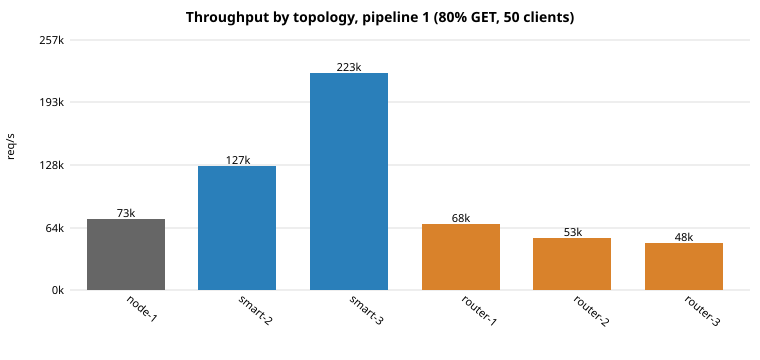
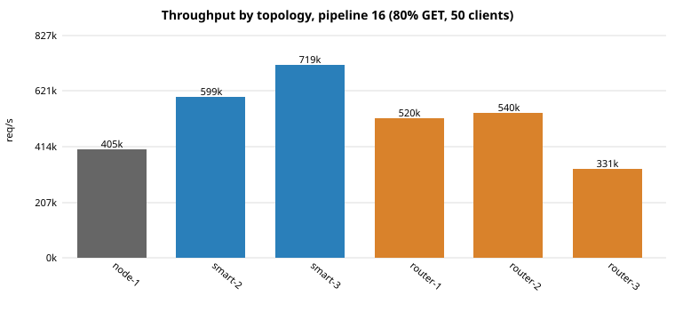
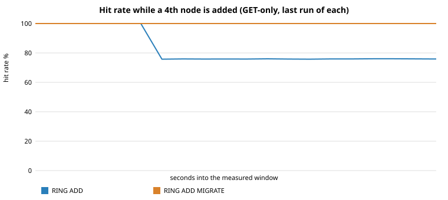

<!-- This file is one section of the original single-page README, moved here unchanged apart from heading levels and link paths. Phase 8 onward were written as separate documents. -->

# Phase 7: distribution with consistent hashing

One node holds all keys and is limited by one machine's memory and by the CPU of its worker
threads. Phase 7 spreads the keys over several nodes: a **consistent hash ring with virtual
nodes** decides which node owns a key, a **router** lets any client (redis-cli included) talk to
the cluster as if it were one node, a **smart-client mode** in the load generator routes with the
same ring without the extra hop, and **rebalancing** lets nodes be added and removed while the
cache is serving traffic. As in Phase 6, every number is a measurement on this one machine and
the limits are written down.

## 1. Summary

| question | answer | where |
|---|---|---|
| How many keys move when a node joins? | 28.6 % of sampled keys for 3 -> 4 nodes (ideal 25 %), against 75 % for `hash(key) % N`. **No key ever moved between two old nodes.** 24.1 % of 100k keys in the live test | §3 |
| How even is the placement? | 160 virtual nodes per node: shares within +/- 5 % (3 nodes) to +15 % (10 nodes, worst node) of fair | §3 |
| Does scaling out help? | Client-side routing: 1.7x / 3.0x with 2 / 3 nodes unpipelined, 1.5x / 1.8x at pipeline 16, 2.0x for 3 nodes at pipeline 64. **Through the router: no** (0.7x-1.3x): the proxy hop saturates its core | §7 |
| What does adding a node cost a running cache? | Without migration: hit rate falls by exactly the moved fraction (100 % -> 75.9 %) and stays there. With migration: hit rate stays 100 %, ~2 s for 100k keys, throughput drops ~70 % while it runs | §6, §7 |
| Is migration safe under concurrent traffic? | Tested with clients checking every reply against a model while nodes are added and removed; 4 deliberate protocol breakages are all caught | §8 |

## 2. What is being solved

*Partitioning*: given a key, which node stores it, such that (1) every client and router agrees
without asking anyone, (2) keys are spread evenly, and (3) when the node set changes, as few keys
as possible change owner. The obvious answer, `hash(key) % N`, satisfies (1) and (2) and fails
(3) badly: going from N to N+1 nodes re-maps about N/(N+1) of the keys. For a cache that is a
miss storm against the backing database. Consistent hashing re-maps only the keys the new node
takes over.

## 3. The ring

```
        0 ──────────────────────────► 2^64-1  (wraps around)
   ●a3     ●b1   ●a1       ●c2  ●b2     ●c1   ●a2        each ● = one virtual node of a node
                     ▲
          hash("user:42") lands here → the first ● at or after it owns the key: a1 → node a
```

* **Hash function:** MurmurHash64A, seed 0 (`src/hash.hpp`). It is part of the placement
  contract, so its output is pinned by `tests/test_ring.cpp` against values produced by an
  independent Python implementation (`tests/murmur_ref.py`); changing it would silently
  re-map every key of every cluster.
* **Virtual nodes:** a node places `160 x weight` points at `hash(name "#" i)`. One point per node
  gives wildly uneven arcs (see the table); many points average that out, with relative
  standard deviation about `1/sqrt(points)`. Because a point depends only on the node's *name*,
  existing nodes keep their points when others come and go, which is what makes movement
  minimal.
* **Immutable ring:** `HashRing` is built once and never changed, so any number of threads read
  it without locks. A topology change builds a new ring (`with_node` / `without_node`) and
  swaps a pointer. The ring depends only on the *set* of (name, weight) pairs, not on the order
  they were added in: tests check that two processes with the same membership agree.
* **Hash tags:** `user:{42}:cart` and `user:{42}:profile` hash only the part inside `{}`, so
  related keys land on one node (same rule as Redis Cluster). This is how an application keeps
  multi-key operations on a single node.
* **Replication hook:** `owner_indices(h, n)` returns the next n *distinct* nodes clockwise,
  which is exactly the replica set Phase 8 needs.

Measured with `bench_ring` (`docs/benchmarks/phase7/ring-analysis.txt`; exact shares, 200k
sampled keys, deterministic):

| nodes | vnodes | min / ideal | max / ideal | stddev / mean |
|---:|---:|---:|---:|---:|
| 10 | 1 | 0.106 | 3.655 | 1.013 |
| 10 | 16 | 0.649 | 1.391 | 0.222 |
| 10 | 64 | 0.741 | 1.313 | 0.161 |
| 10 | **160** | **0.862** | **1.145** | **0.085** |
| 10 | 512 | 0.924 | 1.091 | 0.045 |
| 5 | 160 | 0.879 | 1.065 | 0.065 |
| 3 | 160 | 0.976 | 1.047 | 0.033 |

(One point per node: one node owns 3.7x its fair share, another a tenth. With few nodes the
trend is noisy, e.g. 3 nodes at 64 vnodes is worse than at 16: it is a random placement, and
more points improves the *expected* balance, not every instance.)

| N -> N+1 | ideal | ring | `hash % N` | moved between two old nodes |
|---|---:|---:|---:|---:|
| 2 -> 3 | 0.333 | 0.354 | 0.667 | 0 |
| 3 -> 4 | 0.250 | 0.286 | 0.751 | 0 |
| 4 -> 5 | 0.200 | 0.208 | 0.802 | 0 |
| 8 -> 9 | 0.111 | 0.119 | 0.888 | 0 |
| 32 -> 33 | 0.030 | 0.035 | 0.970 | 0 |

Removing a node moves `1/N` of the keys (3 -> 2: 0.328 against an ideal 0.333; 32 -> 31: 0.0312),
and nothing but that node's keys. The ring's own lookup costs 38 ns (3 nodes) to 73 ns (100
nodes, 16,000 points) plus 8 ns to hash a key: negligible next to a network round trip.

## 4. Where routing lives

| option | what it is | trade-off |
|---|---|---|
| **smart client** | the client holds the ring and talks to nodes directly | no extra hop, best throughput; every client needs the membership and must be told when it changes |
| **proxy / router** (built) | one address; the router owns the ring | clients stay trivial, topology can change in one place, **migration can be made safe because all traffic passes one point**; costs a hop and is a single point of failure |
| server-side redirect (Redis Cluster's `MOVED`) | nodes know the map and bounce clients | no proxy, needs a slot map and redirect handling in clients; not built |

I built the proxy (it is also what makes safe live migration possible, §6) and the smart-client
mode in the load generator (so the proxy's cost can be measured against the alternative).

## 5. The router (`distcache_router`)

```
redis-cli ─► router ─► node a        distcache_router --port 6390 \
load gen  ─►        ├─► node b           --node a=127.0.0.1:7001 --node b=127.0.0.1:7002 ...
                    └─► node c
```

* **Threading:** one thread per client connection, blocking sockets; each client thread owns its
  own connection to every node it has used (no shared pool, no locks on the data path). Simple
  and correct, and it does not scale to thousands of clients (§9).
* **Pipelines:** a batch of commands is sent to all nodes first and the replies are read back in
  command order, so a pipelined batch that touches three nodes costs about one round trip.
  Per-node replies come back in per-node order, which is the order they were queued, so reply
  *k* of a node answers its *k*-th command. Commands that need several nodes are barriers:
  everything before them is answered first.
* **Commands:** `GET SET DEL EXPIRE PEXPIRE TTL PTTL PERSIST` are forwarded by key and the node's
  reply is relayed unchanged (so argument errors come from the node). `DEL k1 k2 ...` is split per
  key and the counts are summed, `DBSIZE` sums the nodes, `KEYS` returns the union, `SAVE`
  broadcasts, `PING`/`ECHO`/`COMMAND` are answered locally, `INFO` describes the router.
* **Admin:** `RING INFO`, `RING LOOKUP key`, `RING ADD name host port [weight] [MIGRATE]`,
  `RING REMOVE name [MIGRATE]`.
* **Failure:** a node that cannot be reached fails *its own keys* with
  `-ERR node 'b' unreachable: ...` and nothing else; a pipelined batch mixing live and dead nodes
  keeps every reply in place (tested). The router does not remove a dead node or fail over;
  detection and recovery are Phases 8 and 10.

## 6. Rebalancing

**Without `MIGRATE`** the ring is swapped and the keys whose owner changed simply miss on their
new owner. That is acceptable for a cache and it is cheap, but note what it does: the data is
still on the old node, now unreachable, taking memory until it expires or is evicted, **and
re-adding a node later can make that stale data reachable again**. The measured loss is exactly
the moved fraction (§7).

**With `MIGRATE`** the router moves the keys. While it runs, the route has two rings, and
commands on a key whose owner changed follow this protocol under that key's stripe lock (one of
1,024 mutexes, chosen by key hash):

| command on a moved key | what happens |
|---|---|
| `GET` | ask the new owner; if it has nothing, ask the old owner (not copied yet) |
| `SET` | `DEL` on the old owner **first**, then `SET` on the new owner |
| `DEL` | `DEL` on both; the reply is 1 if either had it |
| `EXPIRE`, `TTL`, ... | `PTTL` on the new owner; if the key is not there, act on the old owner |

The migration itself scans each source node with `KEYS *` and moves keys in batches of 64:
under the stripe locks of the whole batch (taken in ascending order, so two lockers cannot
deadlock; client threads only ever hold one), pipeline `GET`+`PTTL` from the source, `PTTL` on the
destination (if it already has the key a client wrote a newer value there: the source copy is
only deleted), `SET key value [PX remaining]` on the destination, and `DEL` on the source for
every copied or superseded key. The time to live travels with the key.

Why it is correct (for clients of **this router**): a client operation on a moved key holds the
same stripe lock for its whole network exchange, so each migration step is atomic with respect to
it. Unlocked fast-path batches (no migration running) are drained before the first step: the
router publishes the migrating route and waits for an in-flight counter to reach zero, and a
batch that started earlier leaves the fast path as soon as it notices the new route. (A
reader/writer lock would do the same job but glibc's prefers readers and could starve the
migration under constant traffic.)

What it does **not** protect against: clients that bypass the router (smart clients writing
directly to nodes), or a second router migrating at the same time. The single-router assumption
is stated in the code and here; Redis Cluster solves it with per-key atomic `MIGRATE` and
`ASK` redirects, which this does not implement. Keys left behind because a node was unreachable
are counted in the `errors=` field of the reply and become orphans.

## 7. Benchmarks

Harness: `bench/harness/bench_cluster.py` (same methodology as Phase 6: rounds of every variant
in seeded random order, fresh processes per run, pinned CPUs, health probe at start and end,
`raw.jsonl` + `env.json`). Each node is a 1-worker server on its own **physical** core (cpus 0,
2, 4; this CPU has 2 hyperthreads per core), the router has a core to itself (6-7), the load
generator has the last two cores (8-11). 50 clients, 80 % GET, 100k uniform keys, 64-byte values,
preloaded, 8 s measured, 5 repeats. Report: `docs/benchmarks/phase7/cluster-report.md`.




| topology | P1 req/s | vs 1 node | P16 req/s | vs 1 node | P64 req/s | vs 1 node | router CPU (cores, P1 / P16 / P64) |
|---|---:|---:|---:|---:|---:|---:|---|
| 1 node, direct | 73.1k | 1.00x | 404.6k | 1.00x | 719.5k | 1.00x | - |
| 2 nodes, smart client | 127.5k | 1.74x | 599.3k | 1.48x | | | - |
| 3 nodes, smart client | 223.3k | 3.05x | 719.4k | 1.78x | 1,406k | 1.95x | - |
| 1 node behind router | 67.5k | 0.92x | 520.2k | 1.29x | | | 1.96 / 1.42 / |
| 2 nodes behind router | 53.4k | 0.73x | 540.5k | 1.34x | | | 1.97 / 1.96 / |
| 3 nodes behind router | 48.3k | 0.66x | 331.1k | 0.82x | 957.7k | 1.33x | 1.97 / 1.97 / 1.97 |

Reading it:

* **Client-side routing scales.** At pipeline 1 every node is saturated by its share (node CPU
  0.99 / 1.94 / 2.79 cores) and throughput follows: 1.74x and 3.05x for 2 and 3 nodes (3.05
  is above the ideal 3.0: the 1-node baseline had a 14 % CV, i.e. noise).
* **Sub-linear at pipeline 16, and it recovers with depth.** A client's batch of 16 is split
  over the nodes, so each node receives ~5 commands per round trip instead of 16 and pays more
  syscalls per request: node CPU per request is 2.4 us for one node and 4.0 us for each of
  three. At pipeline 64 the per-node batch is ~21 and 3 nodes deliver 1.95x. I did not test the
  splitting as the *only* cause (the busiest of the 3 nodes also holds 36.5 % of the keys against
  33.3 % fair, and the load generator has two cores), but the P1/P16/P64 trend is the pattern
  batching would produce.
* **The router is the bottleneck, by construction.** Its two hyperthreads are saturated
  (1.96-1.97 cores) in every multi-node row. Per request it spends ~40 us of CPU at pipeline 1,
  ~6 us at 16 and ~2 us at 64: a proxy does the network work of the request a second time
  (recv, send, recv, send) plus two thread wake-ups per exchange. Adding nodes behind it
  therefore does not add throughput, and more nodes can make it worse (more, smaller
  sub-batches per client batch). A faster router needs an event loop (or several stateless
  routers); that is the next step, not something this table argues away.
* **One anomaly I cannot explain:** one node behind the router is *faster* than the same node
  hit directly at pipeline 16 (1.29x here, 1.38x in the earlier session, 1.39x in a third
  run taken in a degraded state), with the node at 0.99 cores in both, so it does more requests
  per CPU-second when they arrive through the router. Plausible (untested): the router
  de-synchronises the 50 clients' bursts. Do not read it as "a proxy speeds a node up".

Variability: this suite ran twice (`cluster-session-A.md` is the first, the report is the second).
Absolute numbers differed 15-20 % (the machine's health probe drifted during the evening:
page-cache writes 5.2 -> 2.6 GB/s between the start and the end of session B), the ratios did not
(smart-3: 2.92x / 3.05x at P1, 1.73x / 1.78x at P16; router-3 at P16: 0.81x / 0.82x). Same rule as
Phase 6: compare within a session.

**Adding a node to a running cache** (3 -> 4 nodes behind the router, GET-only, 100k keys,
node added 6 s into a 20 s run, 5 repeats each):



| variant | keys moved | `RING ADD` takes | hit rate before / lowest during / after | req/s before / during / after |
|---|---|---:|---|---|
| `RING ADD` | - | instant | 100 % / 75.8 % / 75.9 % | 332.6k / 270.2k / 260.6k |
| `RING ADD ... MIGRATE` | 24,113 of 100,000 | 2.25 s | 100 % / **100 %** / 100 % | 333.7k / **89.1k** / 260.3k |

* The loss without migration is the moved fraction: 24.1 % of the keys miss, **for as long as
  nothing rewrites them**. (A write-heavy workload would heal it by itself as keys are re-SET on
  their new owner; this GET-only one cannot.)
* Migration keeps every read a hit, at the price of throughput: during the ~2 s the router runs
  one command at a time (no cross-node pipelining) under stripe locks, and the sources serve
  `KEYS *` and the copies. Throughput falls ~73 % and recovers.
* Both variants end ~22 % below the pre-add throughput: four nodes means more, smaller
  sub-batches per client batch at the router (the same effect as above), and the 4th node
  shares a physical core with n0.
* 100k keys scanned and 24k moved in ~2.25 s is ~44k scanned keys/s, ~11k moved keys/s. The scan cost is
  proportional to ALL keys on every source node, not to the keys that move.

A scripted tour with `redis-cli` is in `docs/benchmarks/phase7/demo.txt` (`scripts/demo_cluster.sh`).

## 8. Verification

* **Ring** (`tests/test_ring.cpp`, 17 tests): pinned hash vectors; placement independent of
  insertion order; adding a node moves keys *only to the new node* and about 1/(N+1) of them for
  N = 1..9; removing a node moves only its keys; modulo placement moves > 75 %; balance improves
  with virtual nodes and stays within 25 % of fair at 160; weights; distinct clockwise owners;
  hash tags; wrap-around; glob matching for `KEYS`, including a hostile pattern.
* **Router end to end** (`tests/test_router.cpp`, 13 tests; real nodes, real router, real TCP):
  every key stored on its ring owner and nowhere else; pipelines across nodes keep reply order;
  multi-node `DEL`/`DBSIZE`/`KEYS`; TTL commands follow the key; a dead node fails only its keys,
  including inside a pipelined batch; add without migration loses ~1/4; add with migration keeps
  every key, every TTL, nothing duplicated, only the new ring's placement; remove with migration
  empties the node; bad topology commands are rejected.
* **The concurrency test:** four client threads each own a disjoint set of keys and check *every
  reply* against their own model (SET / DEL / GET mix) while the main thread adds two nodes and
  removes one with `MIGRATE`. Any stale read, lost write or resurrected delete fails immediately,
  including those in the middle of a migration step. At the end every key must match its model
  and live on its owner only. Passed 15 of 15 repeats.
* **Mutation checks** (four deliberate breakages in a scratch copy, 8 repeats each of the
  rebalance tests): GET without the old-owner fallback fails 8/8; DEL that skips the old owner
  8/8; client operations without the stripe lock 5/8; migration steps without the stripe locks
  4/8 (a race, so a probabilistic catch). Unmodified: 8/8 pass.
* **Whole suite:** 184 pass, 1 skipped by design (155 + 30 new tests) in a plain build, under
  AddressSanitizer + UBSan and under ThreadSanitizer, no reports
  (`docs/benchmarks/phase7/sanitizers.txt`).

## 9. Known limitations

* **The router is a single point of failure and a throughput ceiling** (§7). One thread per
  connection, one process. Multiple *stateless* routers work for static topologies; migration
  needs exactly one.
* **No failure detection, no failover, no replication in Phase 7 itself.** (Phase 8 adds them for
  shards configured with replicas; an unreplicated node that dies still loses its keys.)
* **Membership is manual and local to one router.** There is no gossip, no ring version for
  smart clients, no persistence of membership across a router restart (start it with the same
  `--node` list).
* **Migration scans every key of every source node** (`KEYS *`, O(total keys), built in memory),
  because a node has no index by ring position. Fine at 100k keys; a slot-based design (Redis's
  16,384 slots) would avoid it.
* **Migration pauses pipelining and slows the cluster** while it runs (§7), (Updated in Phase 10: a migration that finishes with errors, e.g.
  because a node was unreachable during a failover, now stays pending and `RING RESUME` completes it.) It is
  still not resumable across a router crash: if the router dies half way, keys are split between old and new
  owners and the next migration or a restart with the old ring is needed.
* **Moved-but-not-migrated data is not cleaned up** (`RING ADD` without `MIGRATE`), and can
  reappear if the ring changes back: stale reads. Use `MIGRATE`, or flush a node before it
  rejoins.
* **Hot keys** are not spread: one key lives on one node. Hash tags can also concentrate load.
* **Multi-key atomicity** across nodes does not exist (`DEL a b` is several independent
  deletes).
* **Ring placement quality** is statistical: a 3-node ring can be 15 % off fair; weights can
  compensate by hand.

## 10. Reproducing

```bash
cmake -S . -B build -G Ninja && cmake --build build
scripts/demo_cluster.sh                          # redis-cli tour: placement, add node, migration
./build/bench_ring 200000                        # ring balance / movement / cost tables
python3 bench/harness/bench_cluster.py --suite all --repeats 5 --out results/mycluster
#   --suite scale | rebalance, --variant-filter "smart-3, P16;router-3, P16", --repeats N
./build/distcache --port 7001 --threads 1 &      # by hand: nodes, then the router
./build/distcache --port 7002 --threads 1 &
./build/distcache_router --port 6390 --node a=127.0.0.1:7001 --node b=127.0.0.1:7002
redis-cli -p 6390 RING INFO
./build/distcache_loadgen --nodes a=127.0.0.1:7001,b=127.0.0.1:7002 --pipeline 16   # smart client
```

## 11. Files added or changed in this phase

```
src/hash.hpp          MurmurHash64A, hash tags
src/hash_ring.*       consistent hash ring (virtual nodes, weights, ownership, owner sets)
src/resp_client.*     blocking RESP client (raw relay and decoded replies, timeouts)
src/router.*          the router: sessions, pipelined forwarding, admin, migration
src/router_main.cpp   distcache_router command line
src/glob.hpp          KEYS pattern matching;   src/commands.cpp: KEYS
bench/bench_ring.cpp  ring analysis;           bench/loadgen.cpp: --nodes (smart client), per-second misses
bench/harness/bench_cluster.py   scale-out and rebalance experiments
tests/test_ring.cpp, tests/test_router.cpp, tests/murmur_ref.py
scripts/demo_cluster.sh
docs/benchmarks/phase7/, results/cluster*, results/ring
```
